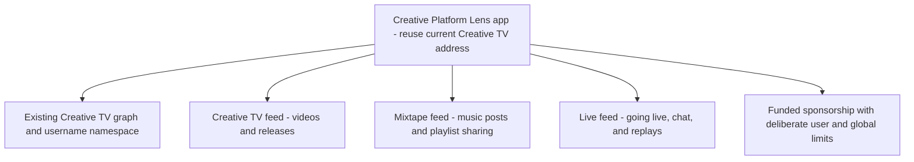

# Native Lens publishing for Creative Mixtape

TL;DR: The user created a dedicated Mixtape app at `0x91c841aF98acEA56c2b63C46Cd7E8F0E000FBaee`. This replaces the earlier umbrella-app proposal below. Creative TV and Creative TV LIVE retain their existing apps.

Status: Mixtape app verified on Lens mainnet November 6, 2026. Its metadata name is Mixtape and its URL is https://mixtape.creativeplatform.xyz/. The latest API read confirms default feed `0x3A0c08Dc03173C8Cf1498c331c31f28cd28f4993`, the existing Creative TV graph and namespace, and no app sponsorship. The user explicitly chose to leave sponsorship as is. Native publishing is implemented locally; signed-in mainnet verification and deployment remain pending. The earlier umbrella structure below is historical reasoning, not the selected deployment target.

Configuration is now established in `lib/lens-config.ts`. Leave sponsorship unlinked. The user reports that the Lens founder confirmed gas is free by default. Use the default Lens publishing flow and leave app sponsorship unchanged. Validate actual mainnet operation responses; if a SelfFundedTransactionRequest is returned, stop rather than silently charge or require a gas deposit. The public docs still describe sponsored and self-funded outcomes, so default coverage has not yet been independently confirmed with this app. Do not fall back to a TV feed. Implementation now includes wallet/account selection, owner/manager authentication scoped to Mixtape, signed creator-account linking, public Pinata metadata, dedicated-feed publishing, submitted-post recovery, confirmed feed/profile posts, editing/deletion, and Hype reactions. The end-to-end signed-in test remains pending.

## Verified resources

Source: read-only queries to `https://api.lens.xyz/graphql`, including app lookup, owner-managed apps, app feeds/groups, owned feeds, and sponsorships. Full public results are recorded in `lens-resource-audit.json`. These are mainnet observations, not inferred environment values.

| Resource | Creative TV | Creative TV LIVE |
| --- | --- | --- |
| App | `0x3412C2509EeF4f9A133E6D3638B9B3c06fc30111` | `0x22C33eaC41E01FA1Fc508Ae4b4b435475B58837E` |
| Default feed | `0x3c336f772167d789d8f781a7002c33451120D74D` | `0xa9761B3b2e94ea5601e72F140cf650b5f4a1aC8e` |
| Graph | `0x2B36706E8E352a273c34D108A5854A55cb2302A6` | `0x433025d9718302E7B2e1853D712d96F00764513F` |
| Namespace | `0x1E643F889D6eD970bADBD231C34F2C7C7105987A` | `0x1aA55B9042f08f45825dC4b651B64c9F98Af4615` |
| Linked app sponsorship | None | None |
| Linked app groups | None returned | None returned |

Both apps have the same owner. The owner-managed app listing also contains Chones and Song Cup; those remain outside this change. Both TV apps are linked to the shared feed `0xcB5E109FFC0E15565082d78E68dDDf2573703580` in addition to their respective default feed. The shared feed has not been selected for Mixtape and its rules/purpose have not been audited. The owner inventory also returns two other unnamed feeds (`0x5D15E5b8848A2BaFB0B968dC4CB6725551F1addb` and `0x3A0c08Dc03173C8Cf1498c331c31f28cd28f4993`); their metadata is null. Neither should be assumed unused or selected for Mixtape without auditing rules, content, and other app links.

An owned sponsorship exists at `0xD4E2e65e8F439657C66f43a1EB2D17803e161508`, named Sponsor. The API reports it is unpaused, allows Lens access, and has a per-user limit of three transactions per day. It reports no global transaction limit. Neither TV app currently links it as its app sponsorship. Funding and actual sponsorship eligibility have not been verified, so gasless publication cannot yet be promised.

Creative TV source references these TV primitives in `/Users/sirgawain/Developer/crtv3/lib/lens/creativetv.ts`. Its live feed code separately supports `NEXT_PUBLIC_LIVE_LENS_FEED_ID`. A separate livestream channel does not, by itself, require a separate Lens app.

## Recommended structure

Reuse the current TV app identity; a metadata rename to Creative Platform can be a later owner-approved change. Do not change the current default feed merely to support Mixtape: native Mixtape publishing should pass the Mixtape feed address explicitly. Do not silently send Mixtape posts to a TV feed when its own feed is missing.

Retain the existing TV graph and namespace to preserve its follower and username relationships. Existing Live graph relationships and names do not automatically merge into TV's resources; inventory and any migration must be explicit. The existing Live app can remain deployed while its feed is evaluated for linkage to the umbrella app. No evidence of inactivity is inferred just from its name or current app configuration.

One app concentrates attribution, authorization, and gas sponsorship policy. Multiple apps remain an option if the products need independent administrators, sponsors, terms, or security boundaries; they can still reference shared social resources. A shared app with distinct feeds is the recommendation for the user's current unified-platform direction, not a Lens requirement.

## Native publishing flow

1. Keep the existing Privy/Mixtape creator identity and mix ownership.
2. Let the user connect a Lens account owned or managed by their connected signer. Select the account explicitly when several are available.
3. Authenticate that Lens account for the selected app using the Lens challenge flow. Never request a private key or conflate the Base smart-account address with a Lens account.
4. Build text/link post metadata and upload it to public storage. Reuse existing Pinata storage after verifying its hosting meets Lens metadata requirements; do not default to a new storage vendor.
5. Submit to the explicitly configured Mixtape feed through the Lens SDK/API from inside Mixtape. Surface any signing request in the app.
6. Await the transaction/indexing result; persist the Lens post ID and creator association only after confirming the result. Pending, rejected, failed, and published are different states.
7. Render confirmed Lens posts in the Mixtape feed and the creator's page. Add reactions against real Lens post IDs.

Sponsorship must be verified before a gasless button is offered. A failed sponsorship should not silently fall back to a paid transaction. Native Lens posting does not grant X publishing permissions: direct X posting is a separate OAuth/API integration.

## Required configuration before a live implementation can be completed

- Confirm the umbrella app target: recommended existing Creative TV address above.
- Create or identify a dedicated Mixtape feed, audit its posting rules, and link it to that app. No dedicated Mixtape feed was established by this audit.
- Link and fund the intended sponsorship, and set appropriate cross-product limits. Existing three-per-day user limits may be too restrictive for posts, comments, and follows together.
- Verify app authorization policy for Mixtape's domain and publishing account flow.
- Supply the resulting public app/feed configuration to Mixtape, then implement and verify native publishing end to end with a user-controlled account.

No app metadata, default feed, graph, namespace, sponsorship, or contract has been changed by this audit. The current external composer remains the implemented behavior until the native integration replaces it; it is not presented as the requested final architecture.

## Official references

- https://lens.xyz/docs/protocol/concepts/app
- https://lens.xyz/docs/protocol/concepts/feed
- https://lens.xyz/docs/protocol/apps/manage
- https://lens.xyz/docs/protocol/apps/authorization-workflows
- https://lens.xyz/docs/protocol/feeds/post
- https://lens.xyz/docs/protocol/sponsorships/sponsoring-transactions

## Implementation verification — November 6, 2026

- SDK: the registry latest tag points to an April 2025 build; use the newer published canary from August 2025, matching the official protocol examples. Mainnet environment is imported explicitly from `@lens-protocol/env`.
- Read-only live SDK query successfully fetched the dedicated Mixtape feed (currently zero posts).
- Private keys and Pinata credentials remain server-side or inside Privy wallet providers. Metadata URIs use public `ipfs://` CIDs, never gateway access tokens.
- Linking a Lens account to a Mixtape creator requires a five-minute, one-use database challenge, a wallet signature, and a live Lens owner/manager lookup. The creator's existing wallet and mix ownership are unchanged.
- Lens mutation results are inspected before wallet handling; self-funded requests stop. No app/feed/sponsorship configuration is mutated.
- X currently retains its explicit composer handoff. Direct X posting needs X OAuth and API configuration; it is not implemented by the Lens integration.
- No public test post has been published. Wallet-approved publishing, edit/delete, and reaction tests require the user's account.

### Local verification evidence

Production build and TypeScript checks pass, with the existing optional Privy module warnings. Signed-out metadata upload and linking return HTTP 401. An authenticated disposable local fixture received a signed link challenge (200); a valid EOA signature for an account it did not manage was rejected (403), and no binding was stored. Empty metadata was rejected (400), with no upload performed. The fixture creator/session were removed afterward. SQLite and libSQL migration checks cover adding the Lens mapping table without changing existing ownership.

Browser verification found and fixed native dialogs covering Privy: app dialogs now suspend while the Privy modal is open, retaining the draft. Privy supports Lens as an additional chain; sponsored operations switch the selected wallet to Lens mainnet. Sponsored operations must include a paymaster and zero transferred value. Submitted edits/deletions retain their hash for confirmation checks rather than resubmission.

Final local checks: production build and TypeScript pass; 12 automated tests pass. Database-backed link challenge returns 200, rejects a correctly signed unmanaged account with 403, and rejects an expired challenge with 400. No binding or public post was created by these checks. Live wallet-approved publication and deployment remain pending.

### Wallet verification preview

Privy's hCaptcha reports that localhost is unsupported. Use the protected HTTPS preview for the MetaMask sign-in test. Keep bot checks enabled. The Privy portal is excluded from Mixtape's generic control styles; it uses the SDK light theme, Mixtape logo, and pink accent. Browser verification showed the dark input, heavy shadows, and bordered footer links were removed. The preview includes the Lens API and RPC in the site's connection allowlist.

Vercel Preview has Privy and Turso settings, but `PINATA_JWT` is currently configured only for Production. The Preview can verify wallet sign-in and account linking. A complete hosted publishing test also needs approved public metadata storage credentials for the test environment.
